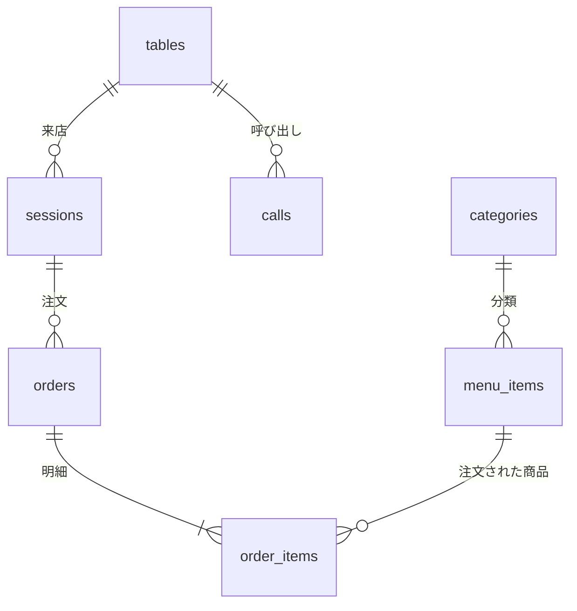

# insyoku-oder

「尾関屋」の、テーブルに置いたタブレットから注文するための Web アプリです。
Python 3.11 以降があれば、追加のインストールなしで動きます（標準ライブラリだけを使用）。

## 起動

```sh
python server.py
```

ブラウザで http://localhost:8000/ を開き、使う画面を選びます。
同じ Wi-Fi のタブレットやスマートフォンからは、起動時に表示される `http://<PCのIPアドレス>:8000/` を開きます
（Windows ではファイアウォールの許可が必要な場合があります）。

| 画面 | URL | 使う人 |
| --- | --- | --- |
| テーブル端末 | `/table?table=1` | お客様（各テーブルのタブレット） |
| キッチン | `/kitchen` | 調理担当 |
| ホール / レジ | `/staff` | ホールスタッフ・レジ担当 |

オプション: `--port 8080`、`--host 127.0.0.1`、`--db パス`、`--reset`（データを消して初期メニューに戻す）

## 運用の流れ

1. **着席**：タブレットでお客様が人数を選ぶ（またはスタッフがホール画面で着席登録）。続けて代表の方の年代・性別を選ぶと、「あなたへのおすすめ」に合った料理が紹介される（スキップ可・後から変更可）
2. **注文**：カテゴリからメニューを選んでカートに入れ、「注文を確定する」
3. **調理**：キッチン画面に注文が表示される。「調理開始」→「提供済」と進める
4. **呼び出し**：タブレットの「店員呼び出し」「お水」がホール画面に通知される
5. **会計**：タブレットで「お会計」→ ホール画面で「会計完了」を押すと、タブレットは次のお客様用の画面に戻る

ホール画面の「メニュー設定」タブで、商品ごとに「おすすめ」と「売り切れ」を切り替えられます。おすすめにした商品は、テーブル端末のメニュー先頭の「本日のおすすめ」に大きく表示されます。画面はすべてリアルタイムに連動します。

### アレルギー対応

- 各商品にアレルギー物質（特定原材料8品目＋大豆・牛肉・豚肉・鶏肉・ごま・オレンジ）を表示します。
- テーブル端末の「アレルギー」から食べられない食材を選ぶと、それを含む商品がメニュー・本日のおすすめ・あなたへのおすすめのすべてから外れます。カートに残っていた該当商品は注文できなくなります。
- 指定内容はキッチンの注文票とホール画面にも「⚠ アレルギー」として表示されます。会計が終わると自動で解除されます。
- 商品ごとのアレルギー物質は `db.py` の `MENU_ITEM_ALLERGENS` で設定しています。**初期データは仮の内容なので、実際の運用では必ず実際の原材料に合わせて修正してください。**

### 「あなたへのおすすめ」の選び方

次の点数の合計が高い料理を、最大6品（同じカテゴリからは2品まで）紹介します。

- 料理の特徴（しっかり系・ヘルシー・軽め・甘いもの・お子さま向け・お酒）と年代・性別との相性
- 同じ年代・性別のお客様が過去によく注文している料理（注文が増えるほど精度が上がります）
- ホール画面で「おすすめ」に設定している料理

売り切れの料理と、20歳未満の方へのお酒は紹介しません。重みの調整は `api.py` の `AGE_TAG_WEIGHTS` などで行えます。

## データベース

データは **SQLite**（Python に標準で入っているデータベース）の 1 ファイルに保存されます。別途データベースソフトをインストールする必要はありません。

| 項目 | 内容 |
| --- | --- |
| 保存場所 | `data/insyoku.db`（`--db パス` で変更可） |
| 作成タイミング | サーバーの初回起動時に自動作成し、初期データ（テーブル8卓・メニュー22品）を投入 |
| 定義しているファイル | `db.py`（テーブル定義・初期データ・列の自動追加） |
| Git での扱い | `data/` は `.gitignore` で除外（お店ごとのデータはリポジトリに入れない） |

起動中は `insyoku.db-wal` と `insyoku.db-shm` というファイルも作られます。これは SQLite の WAL モード（複数の端末から同時に読み書きしても待たされにくくする仕組み）用の一時ファイルなので、消さないでください。

### テーブル構成



| テーブル | 内容 | 主な列 |
| --- | --- | --- |
| `tables` | 店内の座席（テーブル） | `id`、`name`（「テーブル 1」など） |
| `sessions` | 1 回の来店（着席から会計完了まで） | `table_id`、`guests`（人数）、`started_at`、`checkout_requested_at`（お会計ボタンを押した時刻）、`closed_at`（会計完了時刻）、`age_group`・`gender`（おすすめ用に入力された年代・性別）、`allergens`（指定されたアレルギー） |
| `categories` | メニューのカテゴリ | `name`、`sort`（表示順） |
| `menu_items` | メニューの商品 | `category_id`、`name`、`description`、`price`（税込・円）、`icon`（絵文字）、`sold_out`（売り切れ）、`recommended`（本日のおすすめ）、`tags`（おすすめ判定用の特徴）、`allergens`（含まれるアレルギー物質）、`sort` |
| `orders` | 1 回の「注文を確定する」 | `session_id`、`created_at` |
| `order_items` | 注文の明細（1 商品につき 1 行） | `order_id`、`menu_item_id`、`name`・`unit_price`（注文時点の商品名と単価）、`quantity`、`status` |
| `calls` | 店員呼び出し・お水・お会計の依頼 | `table_id`、`kind`（`staff` / `water` / `checkout`）、`created_at`、`resolved_at`（対応済みにした時刻） |

**値の決まりごと**

- **日時**：タイムゾーン付きの ISO 8601 形式の文字列（例：`2026-10-19T14:48:00+09:00`）
- **真偽値**（`sold_out`・`recommended`）：`0` / `1`
- **`tags` と `allergens`**：英語キーのカンマ区切り（例：`egg,milk,wheat`）。使えるキーは `api.py` の `TAG_REASONS`（特徴）と `ALLERGENS`（アレルギー物質）にあります

| アレルギーのキー | egg | milk | wheat | shrimp | crab | walnut | buckwheat | peanut | soy | beef | pork | chicken | sesame | orange |
| --- | --- | --- | --- | --- | --- | --- | --- | --- | --- | --- | --- | --- | --- | --- |
| 表示名 | 卵 | 乳 | 小麦 | えび | かに | くるみ | そば | 落花生 | 大豆 | 牛肉 | 豚肉 | 鶏肉 | ごま | オレンジ |

- **注文明細の `status`**：`pending`（受付済）→ `cooking`（調理中）→ `served`（提供済）。`cancelled`（取消）にした明細は合計金額に含みません

### データの流れと保存のされ方

- **来店ごとの記録**：テーブルの「空席・ご利用中・会計待ち」は保存していません。`sessions` から毎回判断しています。閉じていない（`closed_at` が空の）来店がなければ空席、`checkout_requested_at` が入っていれば会計待ちです。1 テーブルに同時に開ける来店は 1 つだけで、データベースの制約で保証しています。
- **会計完了**：`closed_at` が記録されます。年代・性別・アレルギーの指定はこの来店に紐づいているので、次のお客様には引き継がれません。
- **注文時点の値の保持**：注文の明細には、商品名と単価を注文した時点の値で複製して保存します。後でメニューの値段を変えても、過去の注文金額は変わりません。
- **過去データの扱い**：会計済みの来店・注文も削除せずに残ります。この記録は「同じ年代・性別のお客様に人気」の判定や売上の集計に使えます。自動で削除する仕組みはありません。

### 初期データを変える（データを消してよい場合）

メニュー・カテゴリ・テーブル数・おすすめ・特徴タグ・アレルギーの初期値は `db.py` にあります（`MENU_ITEMS`、`CATEGORIES`、`TABLE_COUNT`、`RECOMMENDED_ITEMS`、`MENU_ITEM_TAGS`、`MENU_ITEM_ALLERGENS`）。書き換えたら次のコマンドで作り直します。

```sh
python server.py --reset
```

⚠ `--reset` はデータベースを削除して作り直すので、**注文履歴を含むすべてのデータが消えます**。

### データを残したまま修正する

営業中のデータを残したまま値段やアレルギー情報を直したい場合は、SQL で直接書き換えます。Python の対話モードを使えば、追加のソフトなしで実行できます（GUI で操作したい場合は「DB Browser for SQLite」などのツールも使えます）。

```text
> python
>>> import sqlite3
>>> conn = sqlite3.connect("data/insyoku.db")
>>> conn.execute("UPDATE menu_items SET price = 950 WHERE name = 'チーズインハンバーグ'")
>>> conn.execute("UPDATE menu_items SET allergens = 'egg,milk,wheat,soy' WHERE name = 'チーズインハンバーグ'")
>>> conn.execute("""INSERT INTO menu_items (category_id, name, description, price, icon, tags, allergens, sort)
...              VALUES (5, '抹茶プリン', '香り高い宇治抹茶のプリン', 399, '🍮', 'sweet', 'egg,milk', 100)""")
>>> conn.commit()
>>> conn.close()
```

- `conn.commit()` を実行するまで変更は保存されません。
- サーバーを動かしたままでも書き換えられます。ただし SQL での変更は各画面に自動では通知されないので、書き換えた後は各画面を再読み込みしてください。
- アレルギー情報は**お客様の健康に関わる情報**です。変更した後は、テーブル端末の商品詳細で正しく表示されることを必ず確認してください。

### 集計の例

同じ方法で、たまったデータを集計できます。

```sql
-- 日別の売上と組数（会計済みの来店のみ。取消した明細は除く）
SELECT substr(s.closed_at, 1, 10)        AS 日付,
       COUNT(DISTINCT s.id)              AS 組数,
       SUM(oi.unit_price * oi.quantity)  AS 売上
FROM sessions s
JOIN orders o       ON o.session_id = s.id
JOIN order_items oi ON oi.order_id = o.id
WHERE s.closed_at IS NOT NULL AND oi.status != 'cancelled'
GROUP BY 日付
ORDER BY 日付;

-- よく注文される商品トップ10
SELECT oi.name, SUM(oi.quantity) AS 数量
FROM order_items oi
WHERE oi.status != 'cancelled'
GROUP BY oi.menu_item_id
ORDER BY 数量 DESC
LIMIT 10;
```

Python の対話モードで実行する場合は、`conn.execute("SQL文").fetchall()` で結果を表示できます。

### バックアップ

- **サーバーを止めてからコピーする場合**：`data/insyoku.db` をコピーするだけで十分です。
- **営業中に取る場合**：ファイルをそのままコピーすると、`-wal` ファイルに書き込み途中のデータが入らないことがあります。営業中は SQLite のバックアップ機能を使ってください。

```text
>>> import sqlite3
>>> src = sqlite3.connect("data/insyoku.db")
>>> dst = sqlite3.connect("data/backup-20261019.db")
>>> src.backup(dst)
>>> dst.close(); src.close()
```

戻すときは、サーバーを止めてからバックアップのファイルを `data/insyoku.db` として置き直し、同じフォルダにある `insyoku.db-wal` と `insyoku.db-shm` を削除します。

### バージョンアップ時の列の自動追加

このアプリの更新で列が増えた場合（例：おすすめ・アレルギー機能の追加）は、サーバーの起動時に `db.py` の `_migrate()` が不足している列を自動で追加します。データは消えません。**新しいプログラムを反映するには、サーバーの再起動が必要です。**

## テスト

```sh
python -m unittest
```

テストは毎回一時的なデータベースを作って実行するので、`data/insyoku.db` には影響しません。

## 注意

- 各画面にログインはありません。店内の閉じたネットワークでの利用を想定しています。インターネットに公開する場合は、ホール・キッチン画面に認証を追加してください。
- データベースには、お客様が入力した年代・性別・アレルギーが来店ごとに保存されます（氏名など個人を特定する情報は保存しません）。
